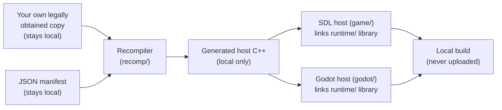

<div align="center">

# Dragon Quest IX (DQ9) — European Decompilation & Native Runtime Research

**Open-source research tooling for *Dragon Quest IX: Sentinels of the Starry Skies* (European Nintendo DS release).**

ARM9/ARM7 static recompilation · C++20 Nintendo DS runtime · Experimental SDL2 and Godot hosts

[](LICENSE)


</div>

> **Experimental — bring your own copy; not a finished port.** The public repository provides original tooling, runtime components and synthetic tests. It does **not** include game data, generated game code, or compiled game builds. `tools/build_port.py` builds a local program from *your own* copy; it currently reaches the opening credits and START prompt (see [Getting started](docs/GETTING_STARTED.md)). See [Status](#status) and [Legal](#legal).

> **Bring your own copy.** This repository contains original code only. It does not include the game, any game asset, recovered or generated game code, or any compiled build, and none is published here. See [Legal](#legal).

DQ9-Decomp explores whether the European version of *Dragon Quest IX* can eventually run through a faithful native host on modern hardware. The current work combines original reverse-engineering tools, ARM/Thumb static recompilation research and native runtime services. **Linux is the immediate development platform; Windows and Steam Deck are targets**, not verified full-game compatibility claims.

**Start here:** [Getting started (plain language)](docs/GETTING_STARTED.md) · [Project status](#status) · [Architecture](docs/ARCHITECTURE.md) · [Runtime-only quick start](#quick-start-runtime-and-tests-only) · [Roadmap](docs/ROADMAP.md) · [FAQ](docs/FAQ.md) · [Configuration](docs/CONFIGURATION.md) · [Legal boundary](LEGAL.md)

---

## What this is

DQ9-Decomp is a research project around one question: *can a Nintendo DS RPG be run natively on a modern PC, faithfully, from the player's own copy?*

It provides the engineering pieces that do not depend on any game content:

| Component | Path | Role |
|---|---|---|
| **Recompiler** | [`recomp/`](recomp) | Turns locally supplied ARM9/ARM7 code into host C++ (static recompilation). |
| **Hardware runtime** | [`runtime/`](runtime) | CPU glue, memory bus, 2D and 3D GPU, sound, peripherals, cartridge and save handling. |
| **SDL2 host** | [`game/`](game) | Desktop front end: windowing, input, audio, launcher, debug capture. |
| **Godot host** | [`godot/`](godot) | GDExtension front end with higher-resolution rendering experiments. |
| **Tools** | [`tools/`](tools) | Build helpers, frame comparison, regression and workflow utilities. |
| **Tests** | [`tests/`](tests), `runtime/*/tests` | Synthetic unit, differential and rendering checks. |

## How it fits together



The recompiler turns a locally supplied image and JSON manifest into host C++, which is compiled with the runtime library for either host. Inputs, generated code and builds stay local; only the components labelled with a repository path are in this repo.

## Highlights

- **Faithful by design.** One simulation drives both classic and enhanced presentation; presentation settings never change game timing.
- **Software 2D/3D rasterizers** with frame-exactness checks against a reference emulator used only as an external oracle.
- **Deterministic debug capture and replay** for reproducing problems without sharing any game data.
- **Parallel band rendering** and a Godot GPU path for high-resolution output experiments.
- **Cross-platform hosts:** Linux desktop first, Windows and Steam Deck as targets.
- **Test-driven:** the default unit and CTest suites use synthetic fixtures only and need no game; optional probes (replay parity, Godot smoke tests) are outside the default suites and require locally supplied inputs.

## Status

### At a glance

| Area | Publicly documented state |
| --- | --- |
| Original tooling and runtime sources | Available |
| SDL2 / Godot host source code | Available for research |
| Runtime-only synthetic tests | Available; not full-game tests |
| Aggregate matching figures | Reported from a local run (dated below); not a fresh full-module or full-ROM validation |
| End-to-end game generator | Not shipped |
| Public playable game / binaries | Not distributed |
| Full-game parity and Windows/Steam Deck validation | Not established |

*As of 2026-10-13.* The recompiler components, hardware runtime, SDL and Godot host sources, development tools and synthetic tests are published. Runtime tests and synthetic rendering checks are **not** proof of full-game compatibility, and device-side Windows and Steam Deck validation is not claimed.

**Matching progress.** 14,555 of 14,794 functions (98.4%) and 2,859,980 of 2,958,414 code bytes (96.67%) match byte-exactly, per the local status report of 2026-10-11 (aggregate totals only; see [docs/DECOMP_STATUS.md](docs/DECOMP_STATUS.md)). This is not re-verified by a fresh full-module check or a full-ROM checksum, and runtime parity with the reference emulator is partial: checkpoint comparisons still differ on several frames.

**Performance.** Author-reported, historical figures (first published 2026-10-13; the measurement date is not recorded and the replay input and raw tables are not public, so they cannot be reproduced from this repository): on a fixed 16,200-frame headless replay (Ryzen 7 6800HS, one pinned core), throughput rose from 150.1 to 175.0 FPS (+16.6%; cycles 494G to 427G). Two intermediate regressions in the 2D compositor and the band-parallel 3D rasterizer had hidden part of the gain until they were bisected and fixed. [docs/BAND_PARALLEL_RENDER.md](docs/BAND_PARALLEL_RENDER.md) documents the band-parallel implementation contract, not these measurements. Set `DSR_RENDER_THREADS` for multi-worker 3D rendering. Wall-clock FPS under load is not an acceptance metric.

**Godot host.** The `DqMachine` GDExtension runs the machine on a worker thread with an audio ring, nonblocking frame slots and a 60 Hz cap (59.8 FPS steady in an earlier, undated, author-reported live run; not independently verified). It provides DS button and touch input with rebinding, resizable screen layouts, save handling, restart, replayable debug bundles and an issue reviewer. An optional GPU path draws captured 3D scenes as sorted textured meshes with DS-compatible shaders and a masked compositor, supports higher-resolution output, and has a zero-crack regression test. Windows cross-builds package the SDL executable and the Godot extension. There is no oracle-parity claim for the high-resolution path.

`tools/build_port.py` runs the local build-from-your-own-copy pipeline (see [Getting started](docs/GETTING_STARTED.md)); verified from a fresh clone: it builds a host that reaches the opening credits and START prompt in all five languages. Gameplay beyond that is unverified (a scripted headless run goes past the title menu into a field scene with `--backup-type eeprom64k`; see [Getting started](docs/GETTING_STARTED.md)). **v0.2.0 adds** hold-to-fast-forward and screenshot hotkeys (with pad combos and a hotkey rebinding page), an optional hi-res 3D overlay (unit-tested only), a small output-identical 2D compositor speed-up, and a **Windows source build kit** (no binaries; CI builds the runtime with Zig on Windows, but a game run on Windows is unverified). No save states: guest threads run on host fibers. **v0.2.1** adds volume/mute, automatic save flushing, a friendlier launcher with ROM checks, preflight checks in the build script and further output-identical speed-ups; see the [CHANGELOG](CHANGELOG.md). Supported game languages: English, French, German, Spanish, Italian (European release only). See the [architecture](docs/ARCHITECTURE.md), [workflow status](docs/DECOMP_STATUS.md) and [roadmap](docs/ROADMAP.md).

## Quick start (runtime and tests only)

Requirements: C++20 compiler, CMake 3.20+, SDL2 development files, Python 3.10+.

Use a local virtual environment with PyYAML and Capstone for the tools; Unicorn is needed for the optional differential tests:

```sh
python3 -m venv .venv
. .venv/bin/activate
python -m pip install PyYAML capstone
# Optional differential tests:
python -m pip install unicorn
```

```sh
cmake -S . -B build/runtime -DCMAKE_BUILD_TYPE=Debug
cmake --build build/runtime
ctest --test-dir build/runtime --output-on-failure

python3 -m unittest discover -s tests -v
```

Without `DQ9_GENERATED_DIR` CMake builds the runtime components and their tests, not a playable game. The SWI differential test uses independent formula checks by default; its optional external-table mode needs `DQ9_BIOS_REFERENCE_SOURCE`, which points to public high-level-emulation source, never a Nintendo BIOS. Details: [Building DQ9-Decomp](docs/BUILDING.md).

## Build a local host

With a separately supplied generated-code directory, the SDL host can be compiled:

```sh
cmake -S . -B build/game -DCMAKE_BUILD_TYPE=Release \
  -DDQ9_GENERATED_DIR="/absolute/path/generated-code"
cmake --build build/game --target dq9
build/game/game/dq9 --rom "$DQ9_ROM" --save "$DQ9_SAVE" --backup-type eeprom64k
```

Set `DQ9_ROM` to an already locally available compatible image and `DQ9_SAVE` to a writable local save path. No title-specific ABI layout is bundled: `DQ9_ABI_CONFIG` (or `--abi-config`) selects a caller-supplied local configuration.

Use **EEPROM 64 KB** for a fresh European-release save (also selectable in the launcher). The
generic Auto fallback is a flash chip and can otherwise produce a corrupt quick-save-log screen.

Platform guides: [Linux and Godot](docs/BUILDING.md) · [Windows](docs/BUILDING_WINDOWS.md) · [Steam Deck](packaging/steamdeck/README.md). Game-host packages contain code generated from the game, so they are local-only and must never be uploaded or distributed, including to CI or GitHub releases. The project publishes no binary releases.

## Documentation

| | |
|---|---|
| [Getting started](docs/GETTING_STARTED.md) | Plain-language guide: can I play it, and what can I run |
| [FAQ](docs/FAQ.md) | Short answers: playability, data boundary, EU version, platforms |
| [Charter](docs/PROJECT_CHARTER.md) | Purpose, scope and the data boundary |
| [Architecture](docs/ARCHITECTURE.md) | Components, execution model, presentation invariants |
| [Tools reference](docs/TOOLS.md) | What each tool does and its exit codes |
| [Roadmap](docs/ROADMAP.md) | Milestones and feasibility gates |
| [Static recompilation decision](docs/DECISIONS/0004-static-recompilation.md) | Why this approach |
| [Launcher and debug capture](docs/LAUNCHER_AND_DEBUG.md) | Private capture and replay workflow |
| [Source credits](docs/RESEARCH_LOG.md) | Prior work this project builds on |

## Contributing

Contributions must be your own original work under the MIT license and must not contain any game-derived bytes, assets, text, symbol or address dumps, or decompiled source. Open an issue before large changes. See [CONTRIBUTING.md](CONTRIBUTING.md).

## Legal

Unofficial, non-commercial fan research. Not affiliated with Square Enix or Nintendo. This repository publishes original tooling and runtime sources, with external references credited in [NOTICE](NOTICE); it does not publish ROMs, assets, decompiled game code, generated game sources, or compiled game builds. Builds and packages that include code generated from the game are derivatives of it and must not be uploaded or distributed; this project publishes no binary releases. The [MIT License](LICENSE) covers the original project code, not the game or other third-party works. See [LEGAL.md](LEGAL.md) for the legal boundary and user responsibilities.

*Dragon Quest* is a trademark of Square Enix. *Nintendo* and *Nintendo DS* are trademarks of Nintendo. Names are used only to identify the game.

### A note to the legal departments 📜

Hello, and thank you so much for the reading time. 🫡 We know your hourly rate, so we kept this short.

We love *Dragon Quest IX* and built this out of curiosity about how it ticks. To keep everyone relaxed:

- We **distribute** no ROM, no art, no music, no text and no game code. You're welcome to search this repository for them. Take your time, we'll wait. ⏳
- We **distribute** no game or binary downloads and no builds. The only thing you can compile here is plumbing, which is admittedly the least glamorous thing a DS game could ask for. 🔧
- We are **not** affiliated with Square Enix or Nintendo. We sell nothing, we earn nothing, and the "business plan" is a hobby and a GitHub account. 📉
- If you'd like anything changed or removed, **open an issue** and we'll look at it promptly and politely. No hard feelings, and no need for the big envelope. ✉️

Respectfully,

The DQ9-Decomp Project

## How this was built (AI disclosure)

This project was developed with AI coding assistance under human direction. This section is the only place the repository mentions it.

- Models: Claude Sonnet 5.5 (Anthropic) was the main coordinating model. Sub-agents ran `gpt-6.1-sol` (OpenAI Codex): medium reasoning for bulk implementation work and for static analysis with Ghidra, and high reasoning for the adversarial and final review passes. All were run through the `omp` terminal coding-agent harness.
- Setup: a human set the goals and reviewed results; the coordinating model read and edited code, ran builds and tests, and delegated bulk work, scouting and reviews to parallel sub-agents.
- Verification did not rely on the model: native output is compared with a reference emulator, and unit and differential tests (Unicorn, CTest, Python `unittest`) gate changes.
- AI output is treated as untrusted until those checks pass. Treat this code as research-grade.
