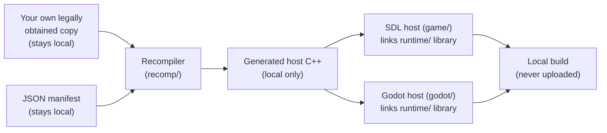

<div align="center">

# Dragon Quest IX (DQ9) on Nintendo DS: Decompilation, Static Recompilation and a Native PC Port

[](LICENSE)


</div>

> [!NOTE]
> This README uses AI to help summarize and translate my ideas into readable sentences.

DQ9-Remastered is a decompilation (decomp) and static recompilation research project for *Dragon Quest IX: Sentinels of the Starry Skies* (DQ9), the European Nintendo DS release. I'm working toward a native port for Linux, with Windows and Steam Deck as targets. The project also has a Godot host with experimental widescreen and HD work.

> **Experimental: bring your own copy; this is not a finished port.** The public repository provides original tooling, runtime components and synthetic tests. It does **not** include game data, generated game code or compiled game builds. `tools/build_port.py` builds a local program from *your own* copy; it currently reaches the opening credits and START prompt (see [Getting started](docs/GETTING_STARTED.md)). See [Status](#status) and [Legal](#legal).

> **Bring your own copy.** This repository contains original code only. It does not include the game, any game asset, recovered or generated game code, or any compiled build, and none is published here. See [Legal](#legal).

I want to find out whether the European version of *Dragon Quest IX* can eventually run faithfully through a native host on modern hardware. The work combines original reverse-engineering tools, ARM/Thumb static recompilation research and native runtime services. **Linux is the immediate development platform. Windows and Steam Deck are targets**, not verified full-game compatibility claims.

**Start here:** [Getting started (plain language)](docs/GETTING_STARTED.md) · [Project status](#status) · [Architecture](docs/ARCHITECTURE.md) · [Runtime-only quick start](#quick-start-runtime-and-tests-only) · [Roadmap](docs/ROADMAP.md) · [FAQ](docs/FAQ.md) · [Configuration](docs/CONFIGURATION.md) · [Legal boundary](LEGAL.md)

---

## What is DQ9-Remastered?

The repository has the pieces that don't depend on game content:

| Component | Path | Role |
|---|---|---|
| **Recompiler** | [`recomp/`](recomp) | Turns locally supplied ARM9/ARM7 code into host C++ (static recompilation). |
| **Hardware runtime** | [`runtime/`](runtime) | CPU glue, memory bus, 2D and 3D GPU, sound, peripherals, cartridge and save handling. |
| **SDL2 host** | [`game/`](game) | Desktop front end: windowing, input, audio, launcher and debug capture. |
| **Godot host** | [`godot/`](godot) | GDExtension front end with higher-resolution rendering experiments. |
| **Tools** | [`tools/`](tools) | Build helpers, frame comparison, regression and workflow utilities. |
| **Tests** | [`tests/`](tests), `runtime/*/tests` | Synthetic unit, differential and rendering checks. |

### Static recompilation and decompilation: what's the difference?

I'm doing two different jobs here. You only need the first one to play.

**1. Static recompilation (the port).** [`recomp/`](recomp) translates the game's ARM9 and ARM7 code into C++ ahead of time, function by function. That C++ is compiled with the hardware runtime into a normal PC program. Nothing is interpreted while you play. The game code runs as native code, while [`runtime/`](runtime) rebuilds the DS hardware it talks to: 2D and 3D graphics, sound, timers, cartridge and save chip. The generated C++ works, but it's machine output and hard to read. Hand edits won't survive the next regeneration from the game code.

**2. Decompilation (the understanding).** Matching functions are written by AI agents using OpenAI Codex models from the gpt-6.1 family, run through the omp terminal coding-agent harness and seeded with Ghidra analysis. A function only counts when its compiler output matches the original bytes exactly. That's a mechanical check, not trust in the AI. The result is C/C++ (or assembly) that a person can read. Because it comes from the game, it stays on my machine; only the progress numbers are public (see [Status](#status)). There are more details in the [AI disclosure](#how-this-was-built-ai-disclosure).

**Why bother with a decomp too?** The port alone can run the game, but it would be a black box. I do both because:

- **The recompiler needs a code map.** Matching work helps show where functions start and end, what's code and what's data, and how overlays point at each other. A wrong map means a wrong translation.
- **Understanding makes hooks easier.** It's easier to find where to hook something, like the camera that Full widens, when I can read what the game does instead of poking at machine code.
- **Matching is a check.** Each matched function rebuilds to the original bytes. The source is checked rather than just guessed.
- **Readable source makes deeper changes easier to maintain.** A recompilation-only port can already change gameplay by hooking or replacing functions in generated code. The widened camera in Full is one such hook. But those hooks are made without readable source and have to survive regeneration. Readable source makes it clearer what I'm changing, so bug fixes, quality-of-life options, new menus and new features become more realistic to build and maintain. No source-level change like that has shipped yet; that's where I hope the decomp will pay off.

### Is this an emulator? How does it compare?

| | Emulator | Static recompilation only | This project (recompilation + decompilation) |
|---|---|---|---|
| Game code | Interpreted or JIT-compiled while you play | Translated to C++ ahead of time, compiled to a native program | Same as recompilation only |
| Games supported | Any game for the system | One game | One game: *Dragon Quest IX* (European release) |
| DS hardware (graphics, sound, timers) | Emulated | Rebuilt in a runtime library | Rebuilt in a runtime library; a reference emulator is used only to check results |
| Readable game source | No | No, only generated code | Yes, about 12,000 functions in C/C++ (kept locally) |
| Changing the game itself | Patches, cheat codes | Hooks or edits on generated code; works, but blind and fragile across regeneration | Same hooks, guided by readable source; source-level changes possible (not used yet) |
| What you need | Emulator + your game | Your game | Your game; the build runs locally and nothing generated is distributed |
| Original-behaviour reference | The emulator itself | Depends on the project | The SDL host (Classic); enhancements live only in the Godot host |

## How does it work?



The recompiler takes a locally supplied image and JSON manifest and produces host C++. That gets compiled with the runtime library for either host. Inputs, generated code and builds stay local. Only the components labelled with a repository path are in this repo.

## What's in the project?

- **Classic and enhanced hosts.** SDL is the Classic reference host. Godot has optional enhancements, including launch-time modes that change guest state and need separate baselines.
- **Software 2D/3D rasterizers.** I check frame exactness against a reference emulator used only as an external oracle.
- **Deterministic debug capture and replay.** These help reproduce problems without sharing game data.
- **Rendering experiments.** Parallel band rendering and a Godot GPU path support high-resolution output experiments.
- **Host targets.** Linux desktop comes first; Windows and Steam Deck are targets.
- **Tests.** The default unit and CTest suites use synthetic fixtures only and need no game. Optional probes, including replay parity and Godot smoke tests, are outside the default suites and need locally supplied inputs.

## Status

### At a glance

| Area | Publicly documented state |
| --- | --- |
| Original tooling and runtime sources | Available |
| SDL2 / Godot host source code | Available for research |
| Runtime-only synthetic tests | Available; not full-game tests |
| Aggregate matching figures | Reported from a local run on 2026-10-29 with all 38 module checks passing; no full-ROM checksum claimed |
| Build-from-your-own-copy pipeline | `tools/build_port.py` and the Windows kit scripts generate and build a local host from your own image; nothing generated is distributed |
| Public playable game / binaries | Not distributed |
| Gameplay range | I report deterministic replays from boot to later field and shop scenes (see below); full-game play-through not yet done |
| Full-game parity and Windows/Steam Deck validation | Not established |

*As of 2026-10-29.* I've published the recompiler components, hardware runtime, SDL and Godot host sources, development tools and synthetic tests. Runtime tests and synthetic rendering checks are **not** proof of full-game compatibility. I'm not claiming device-side validation on Windows or Steam Deck.

**Matching progress.** My local status report of 2026-10-29 says 14,660 of 14,794 functions (99.1%) and 2,935,178 of 2,958,434 code bytes (99.21%) match byte-exactly, with all 38 module checks passing. These are aggregate totals only; see [docs/DECOMP_STATUS.md](docs/DECOMP_STATUS.md). Of the matched functions, 11,935 are written in C/C++ (some with inline assembly) and 2,725 are assembly-only. I claim no full-ROM checksum. Matching work is independent of the recompiled port, which translates every function regardless of matching status.

**Gameplay range.** I report these results from local runs; the replay inputs and saves are game-derived and stay private. A build of this repository replays a ladder of deterministic segments from boot through the title screen, character creation, the Observatory and later field and shop scenes. The longest is 73,311 frames, about 20 minutes of play. On 2026-10-29, each segment reproduced identical frame, save and audio hashes on repeated SDL runs. On 2026-10-27, the Godot host matched the SDL host on these segments with enhancements off. Parity with the reference emulator is partial: early segments still show small timing offsets. A full play-through to the credits has not been done yet.

**Performance.** I report these historical figures, first published 2026-10-13. The measurement date wasn't recorded, and the replay input and raw tables aren't public, so they can't be reproduced from this repository. On a fixed 16,200-frame headless replay (Ryzen 7 6800HS, one pinned core), throughput rose from 150.1 to 175.0 FPS (+16.6%; cycles 494G to 427G). Two intermediate regressions in the 2D compositor and the band-parallel 3D rasterizer hid part of the gain until I bisected and fixed them. [docs/BAND_PARALLEL_RENDER.md](docs/BAND_PARALLEL_RENDER.md) documents the band-parallel implementation contract, not these measurements. Set `DSR_RENDER_THREADS` for multi-worker 3D rendering. Wall-clock FPS under load is not an acceptance metric.

**Godot host.** The `DqMachine` GDExtension runs the machine on a worker thread with an audio ring, nonblocking frame slots and a 60 Hz cap. I reported 59.8 FPS steady in an earlier, undated live run; that result is not independently verified. The host has DS button and touch input with rebinding, resizable screen layouts, save handling, restart, replayable debug bundles and an issue reviewer. An optional GPU path draws captured 3D scenes as sorted textured meshes with DS-compatible shaders and a masked compositor. It supports higher-resolution output and has a zero-crack regression test. Windows cross-builds package the SDL executable and the Godot extension. I make no oracle-parity claim for the high-resolution path.

`tools/build_port.py` runs the local build-from-your-own-copy pipeline (see [Getting started](docs/GETTING_STARTED.md)). Verified from a fresh clone, it builds a host that reaches the opening credits and START prompt in all five languages; saves need `--backup-type eeprom64k`. **Since v0.2:** there are one-click Windows kit scripts (`BUILD-DQ9.bat`, `PLAY-DQ9.bat`, Godot variants and `COLLECT-DIAGNOSTICS.bat`), a validated first-run launcher, rotating save backups with restore, SDL audio recovery and a Godot restore panel. CI exercises the scripts without a game, but a game run on Windows is unverified. Later versions add RTC, touch, GPU3D and timing corrections and a Godot single-screen layout. Experimental Godot widescreen and HD texture replacement are on the main branch but not yet in a release. See [CHANGELOG.md](CHANGELOG.md), the [architecture](docs/ARCHITECTURE.md), [workflow status](docs/DECOMP_STATUS.md) and [roadmap](docs/ROADMAP.md).

### What's next: a cookbook for other games

Later on, I plan to write a cookbook: a step-by-step guide on how to do the same thing for other games (decompilation, static recompilation, a hardware runtime and a native host), based on what worked and what didn't here. The idea is to share this project's MIT runtime as a starting point, so you don't have to rebuild the whole DS hardware from scratch. Before that, I want to finish the provenance audit and split the DQ9-specific parts from the generic DS parts. It will be a base to learn from and adapt, not a promise of support for other games. None of this exists yet.

### Maybe later: the decompiled source in a separate repository

Once the decompilation is complete, I might release the decompiled source in a separate repository. Nothing is decided yet, and it will never be mixed into this one: this repository stays original code only, with no game-derived content.

## Quick start (runtime and tests only)

You'll need a C++20 compiler, CMake 3.20+, SDL2 development files and Python 3.10+.

Use a local virtual environment with PyYAML and Capstone for the tools. Unicorn is needed for the optional differential tests:

```sh
python3 -m venv .venv
. .venv/bin/activate
python -m pip install PyYAML capstone
# Optional differential tests:
python -m pip install unicorn
```

```sh
cmake -S . -B build/runtime -DCMAKE_BUILD_TYPE=Debug
cmake --build build/runtime
ctest --test-dir build/runtime --output-on-failure

python3 -m unittest discover -s tests -v
```

Without `DQ9_GENERATED_DIR`, CMake builds the runtime components and their tests, not a playable game. The SWI differential test uses independent formula checks by default. Its optional external-table mode needs `DQ9_BIOS_REFERENCE_SOURCE`, which points to public high-level-emulation source, never a Nintendo BIOS. Details: [Building DQ9-Remastered](docs/BUILDING.md).

## How to build a local host from your own copy

With a separately supplied generated-code directory, you can compile the SDL host:

```sh
cmake -S . -B build/game -DCMAKE_BUILD_TYPE=Release \
  -DDQ9_GENERATED_DIR="/absolute/path/generated-code"
cmake --build build/game --target dq9
build/game/game/dq9 --rom "$DQ9_ROM" --save "$DQ9_SAVE" --backup-type eeprom64k
```

Set `DQ9_ROM` to an already locally available compatible image and `DQ9_SAVE` to a writable local save path. No title-specific ABI layout is bundled. Use `DQ9_ABI_CONFIG` (or `--abi-config`) to select a caller-supplied local configuration.

Use **EEPROM 64 KB** for a fresh European-release save. You can also select it in the launcher. The generic Auto fallback is a flash chip and can otherwise produce a corrupt quick-save-log screen.

Platform guides: [Linux and Godot](docs/BUILDING.md) · [Windows](docs/BUILDING_WINDOWS.md) · [Steam Deck](packaging/steamdeck/README.md). Game-host packages contain code generated from the game. They are local-only and must never be uploaded or distributed, including to CI or GitHub releases. The project publishes no binary releases.

## Documentation

| | |
|---|---|
| [Getting started](docs/GETTING_STARTED.md) | Plain-language guide: can I play it, and what can I run |
| [Using the Godot version](docs/USING_GODOT.md) | Build, start, controls, layouts and troubleshooting for the Godot host |
| [FAQ](docs/FAQ.md) | Short answers: playability, data boundary, EU version, platforms |
| [Charter](docs/PROJECT_CHARTER.md) | Purpose, scope and the data boundary |
| [Architecture](docs/ARCHITECTURE.md) | Components, execution model, presentation invariants |
| [Tools reference](docs/TOOLS.md) | What each tool does and its exit codes |
| [Roadmap](docs/ROADMAP.md) | Milestones and gates to the final v1 release |
| [Static recompilation decision](docs/DECISIONS/0004-static-recompilation.md) | Why this approach |
| [Classic and enhanced hosts](docs/DECISIONS/0005-classic-sdl-enhanced-godot.md) | SDL Classic and Godot enhancement policy |
| [Launcher and debug capture](docs/LAUNCHER_AND_DEBUG.md) | Private capture and replay workflow |
| [Source credits](docs/RESEARCH_LOG.md) | Prior work this project builds on |

## Contributing

Contributions must be your own original work under the MIT license. They must not contain game-derived bytes, assets, text, symbol or address dumps, or decompiled source. Please open an issue before making large changes. See [CONTRIBUTING.md](CONTRIBUTING.md).

## Legal

This is unofficial, non-commercial fan research. It is not affiliated with Square Enix or Nintendo. This repository publishes original tooling and runtime sources, with external references credited in [NOTICE](NOTICE). It does not publish ROMs, assets, decompiled game code, generated game sources or compiled game builds. Builds and packages that include code generated from the game are derivatives of it and must not be uploaded or distributed. This project publishes no binary releases. The [MIT License](LICENSE) covers the original project code, not the game or other third-party works. See [LEGAL.md](LEGAL.md) for the legal boundary and user responsibilities.

*Dragon Quest* is a trademark of Square Enix. *Nintendo* and *Nintendo DS* are trademarks of Nintendo. Names are used only to identify the game.

### A note to the legal departments

I built this as a hobby because I'm curious about how *Dragon Quest IX* works. I sell nothing and earn nothing from it.

- I distribute no ROM, art, music, text or game code.
- I distribute no game or binary downloads and no builds. The repository itself builds the tooling and runtime, not a game without your own copy.
- I am not affiliated with Square Enix or Nintendo.
- If you'd like anything changed or removed, please **open an issue**. I'll look at it promptly and politely.

## How this was built (AI disclosure)

I developed this project with AI coding assistance under human direction. Details are here; the decompilation section above also mentions it.

- Models: Claude Opus 5.5 (Anthropic) is the main coordinating model today; earlier work used Claude Sonnet 5.5. Sub-agents run `gpt-6.1-terra` (OpenAI Codex) for bulk implementation, decompilation matching and static analysis with Ghidra; review passes use `gpt-6.1-sol` with high reasoning. Everything runs through the `omp` terminal coding-agent harness.
- Setup: I set the goals, review the results and casually check the code when needed. The coordinating model reads and edits code, runs builds and tests, and delegates bulk work, scouting and reviews to parallel sub-agents.
- Decompilation matching is done by AI agents and verified byte-exactly against the original game bytes.
- Verification did not rely on the model: native output is compared with a reference emulator, and unit and differential tests (Unicorn, CTest, Python `unittest`) gate changes.
- I treat AI output as untrusted until those checks pass. Treat this code as research-grade.
