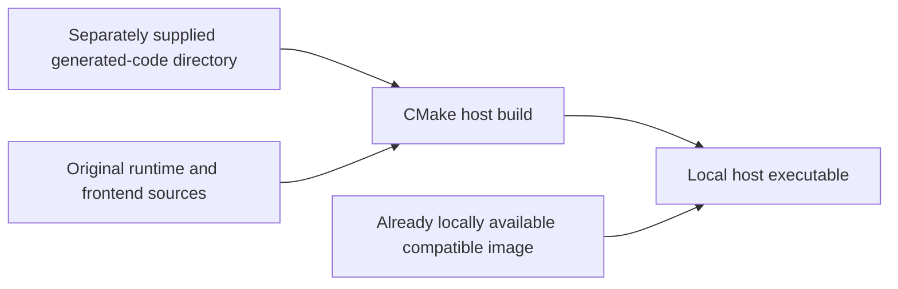

# Architecture

See [ADR-0004](DECISIONS/0004-static-recompilation.md) for why the port is a static recompilation with native DS platform services.

## Public build boundary

The repository publishes original tooling and runtime sources, not a complete
game-generation workflow. A game host consumes a separately supplied
generated-code directory; no instructions for producing it are shipped.

Without generated code, CMake builds runtime libraries and tests rather than
a playable game. Generated game sources, local images, saves, captures, and
compiled game builds remain private and must not be published.

## Components

| Path | Role |
|---|---|
| `recomp/` | ARM/Thumb decoder and C++ emitter: native functions, basic blocks, live guest-memory loads, jump-table handling, and cycle-budget checkpoints. |
| `tools/arm7_analyze.py` | ARM7 function discovery using caller-supplied image and load metadata: autoload parsing, recursive descent, and pointer/jump-table scanning. |
| `runtime/include/dsr/` | Contract: `cpu.h` (guest CPU state), `mem.h` (16 KiB page-table memory access with hardware alignment rules), `rt.h` (helpers called by generated code and the `FnTable` format), component headers. |
| `runtime/core` | `Machine`: memory map, IO routing, IRQ/IE/IF/IME, timers, DMA, IPC sync/FIFO, divider/sqrt, CP15/TCM, BIOS SWI HLE, direct boot, dispatch for indirect/overlay calls, scheduler interleaving ARM9/ARM7 fibers, guest-thread fiber mapping. |
| `runtime/gpu2d` | Engines A/B, VRAM banking, palette/OAM, windows, blending, capture, master brightness (software, per scanline). |
| `runtime/gpu3d` | Geometry engine and software rasterizer. |
| `runtime/spu` | 16-channel SPU: PCM8/PCM16/ADPCM decoding across channels, PSG on channels 8–13, noise on 14–15, and capture; ADPCM deltas use the reference table’s single integer division by eight. Capture 0/1 sample on channel 1/3 timer overflows, even when the playback channel is stopped, independently of the 1024-tick output DAC ([hardware contract](https://problemkaputt.de/gbatek-ds-sound-capture.htm)). |
| `runtime/periph` | Game card and local backup storage, SPI power/firmware/touch, and RTC. Title-specific settings belong to private caller inputs. |
| `runtime/frontend` | SDL2 window/layouts, keyboard/gamepad/touch, audio resampling, 59.8261 Hz pacing, Steam Deck defaults; over-cap audio queues discard stale backlog and append newly resampled audio. |
| `game/` | `dq9` executable: owns the host loop (input → `Machine::run_frame` → present/audio/pace), headless/scripted mode and frame dumps. |
| `tools/oracle` | Comparison tooling for a separately available reference emulator; emulator sources, images, traces, and captures are not bundled. |

## Execution flow

- Generated code keeps guest registers in `dsr::Cpu`; memory goes through page tables (fast path) or the core's slow path (IO, palette, OAM).
- Each guest function decrements `Cpu::budget`; at function entries and loop headers a non-positive budget calls `dsr_checkpoint`, which delivers IRQs (HLE BIOS IRQ entry, guest handler via `dsr_call`) or yields the CPU fiber to the scheduler.
- The scheduler runs on the host main fiber and advances DS bus time (33,513,982 Hz) by scanline events; ARM9 runs two cycles per tick.
- Indirect branches resolve through the generated `FnTable`; addresses shared by several overlays retain the original first-matching FNV-1a64 resolution. A per-CPU/per-target cache reuses the result only after byte-exact, page-by-page comparison with the previous live image. Its snapshot covers the longest candidate examined through the first match (including rejected earlier candidates), or every candidate when none matched. Any change, including an ordinary code store without cache maintenance, causes rehashing. Current page mappings are consulted every time; slow/IO-backed ranges are not cached, and no hooks are added to guest stores or DMA.
- Shared-code region `MOV pc, lr` returns targeting the same region resume through its dispatcher; external returns leave the region after recording the guest return target.
- Guest execution contexts map onto host fibers; context-switch primitives are runtime services, while scheduling decisions remain in generated code.

Hardware timers accumulate elapsed ticks lazily until their earliest overflow
deadline, rather than updating eight counters on every scheduler slice. Timer
reads and writes synchronize counters first; writes recompute the deadline.
Overflow/IRQ/cascade order and the scheduler's existing service boundaries are
unchanged. A prescaler reduction that retains an overdue phase takes effect on
the next positive step, not a same-tick read. Seeded scalar-reference tests
compare both CPUs' counters, controls, synchronized phases and interrupt flags.
Exact IRQ slice limits project elapsed clocks into the synchronized counter
epoch, retaining downstream cascade-IRQ deadlines without forcing a counter
scan on ordinary slices. Forced IRQ checkpoints keep the scheduler's positive
budget reserve/carry unchanged.

The SPU keeps each busy channel's elapsed phase as a global tick origin and
caches the earliest channel deadline. Calls before that deadline avoid the
16-channel phase scan; timer writes and starts lower the cached deadline when
needed. Capture and output-DAC step boundaries and channel event order are
unchanged. Silent samples skip only the subsequent zero-valued pan/mix math.
ROM-free tests compare the original scalar scheduler's ordered memory accesses,
capture bytes, registers and PCM under randomized writes and interval splits.

`MachineConfig::guest_abi` supplies optional CPU context layouts without embedding
title-specific offsets in the runtime. `SessionConfig::abi_config_path` or
`DQ9_ABI_CONFIG` selects the caller's local INI metadata; the SDL host exposes
`--abi-config PATH`. Omitted CPU sections disable those thread overrides with a
diagnostic. Public field definitions live in `runtime/include/dsr/abi_config.h`;
no title layouts are shipped.

### CPU and Slot-1 timing approximation

ARM9 generated blocks charge a reference-calibrated average of **161/64 CPU
cycles per ordinary fetched instruction**. `Cpu::cycle_fraction` carries the
remainder across blocks, calls, scheduler slices, and guest thread switches;
reset clears it. It is CPU timing state, not saved architectural/context state.
A long Thumb BL/BLX counts as two fetched instructions, and failed ARM
predicates still incur their fetch cost. ARM7 retains its integer
instruction-plus-memory estimate. This coefficient is an approximation, not an
ARM946 cache-tag, wait-state, pipeline-hazard, or hardware-accurate timing model.
Generated code and runtime must use the same CPU contract and timing emitter;
rebuilding only the runtime does not update previously generated block costs.

Data SWIs and `WaitByLoop` charge one generated base cycle instead of the ARM9
average. Runtime HLE adds two dispatch cycles plus the reference handler's
returned cycles, on either CPU. A failed conditional data/delay SWI therefore
costs only its one base cycle. `CpuSet`, `CpuFastSet`, square root, CRC, debugger
probe, valid bit unpack, Huffman, ARM9 differential filters, and ARM7 lookup
tables have four-cycle totals, independent of data size; division costs nine
cycles, or three for a zero divisor. Nonempty LZ77/RL completion returns zero
handler cycles (three total), while an initially empty valid stream returns
one (four total). Invalid bit-unpack parameters, a failed callback open, and
invalid stream ranges return handled zero-cycle results; these remain distinct
from unsupported SWIs. No per-byte copy/decompression charge is invented.
`WaitByLoop` totals three cycles plus its loop count times four on ARM7, or
two/eight on ARM9 with/without enabled TCM. Other control SWIs retain their
cooperative halt/wait accounting.

Scheduler slices retain their 128-bus-tick upper bound but also stop at the next timer overflow that will set a timer IRQ flag on either CPU. The boundary calculation uses the enabled non-cascade source's current count, prescaler phase and reload, plus the current counts/reloads of any enabled cascade chain. Non-IRQ overflows are skipped: even a one-tick source does not require one-tick CPU slices when only a later cascade stage requests an IRQ. This removes whole-slice timer IRQ lateness for timer state known at the start of a slice; it does not change timer divisors, CPU cycle estimates or RNG state. Guest execution and IRQ entry still use generated-code checkpoints, and timer writes made during a running CPU slice are not timestamped within that slice. ROM-free core tests cover exact handler-observed ticks on ARM9 and ARM7, split `run_ticks` calls, prescaler remainders, reload changes and cascades. These checks do not establish cycle accuracy, an RNG fix or game/route parity.

An enabled pending IRQ forces the generated-code checkpoint sentinel without consuming CPU time: each CPU retains any displaced positive budget in a separate reserve. The checkpoint and IRQ-entry paths add that reserve back to the live budget before guest execution, including after a scheduler yield, so instructions already charged after the force remain negative debt rather than being forgiven. Repeated IRQ/IME/IE forcing cannot reserve the same cycles twice, and a reserve not yet consumed by a checkpoint survives another scheduler grant. BIOS halt, both idle `IntrWait` paths and HALTCNT discard unused reserve; a full machine reset clears it, while guest-thread switches and `start_cpu` retain this per-CPU accounting. This does not change the 128-tick quantum, timer boundaries, instruction costs or the generated `Cpu` ABI. `dsr_irq_budget_tests` uses ROM-free counting guests and handlers to exercise both CPUs, register enables, target-CPU requests, debt, yield/resume and idle/reset behavior.

Slot-1 schedules its initial READY after `(8 + gap) * clocks + 4` machine
ticks and holds READY until the card block is consumed. CPU polling can read
successive words without another scheduler slice. One readiness callback lets
cartridge DMA drain until the card block ends or the latched DMA count
completes. DMA completion IRQ, repeat rearming, and destination reload happen
once per programmed completion; a repeat channel cannot recursively consume
another block in that callback. Card exhaustion must not create stale extra
writes or a premature DMA IRQ. ROMCTRL size codes 1–6 transfer
`0x100 << code` bytes (512–16384), code 7 transfers four bytes, and code 0 none
([cartridge I/O contract](https://problemkaputt.de/gbatek-ds-cartridge-i-o-ports.htm)).

The held-READY and bounded-DMA changes form one timing contract: holding READY
with a one-unit-per-callback DMA would stall after its first word. Deterministic
ROM-free regressions cover fractional carry/debt, SWI costs, initial READY
latency, successive card data, completion/IRQ boundaries, DMA repeat/count
latching, card exhaustion, and slot ownership. Cross-run comparisons require
identical starting backup bytes as well as inputs, RTC, and CPU policy.
Neither this timing approximation nor synthetic tests establish general frame
parity, hardware accuracy, or native game playability.

### Runtime diagnostics

Set `DSR_WATCH=addr[:length][,addr[:length]...]` to log writes intersecting selected guest-memory byte ranges; numbers accept decimal or `0x` hexadecimal, and an address without a length watches one byte. Watched pages use the core's slow write path, which logs frame, CPU, guest PC, thread context, Fiber identity, address, width, old/new values, guest registers, and CPSR. Generated stores report their exact instruction PC; other runtime-originated writes fall back to the CPU's most recently dispatched guest PC. `runtime/core/THREADS.md` documents the ARM9 stack identity checks and `DSR_TRACE_THREADS` diagnostics.

Set `DSR_VERIFY_DISPATCH=1` to compare every reused ambiguous resolution with the original live byte-hash resolver and abort on a different selected entry. Cache misses already execute that resolver; slow/IO reads are not repeated. This diagnostic deliberately restores the hashing cost on hits; leave it unset for performance measurements.

## Presentation invariants

- Presentation (layout, scale, filter, fullscreen) is frontend-only and never feeds back into the machine.
- The machine advances exactly one DS frame per `run_frame`; host pacing never speeds up simulation.
- Classic mode renders at native 256×192 per screen. Optional enhanced presentation must leave simulation state identical; see [render capture](REMASTER_STAGE1.md).

### GPU raster hot paths

GPU2D uses page-mapped VRAM reads with an overlap fallback, scanline text-map/byte/palette caching, direct OAM reads with hoisted object-matrix state, and priority lists limited to enabled backgrounds. GPU3D prepares shading/texture-wrap state per polygon and skips empty spans. These implementation choices imply no game-wide performance or parity result.
Regular BG/OBJ palette RAM also maintains decoded colours eagerly on each
accepted write and reset; ignored byte stores remain ignored. Extended palettes
stay on the live VRAM path, including overlapping mappings. Scalar-reference
tests cover reset, mirrored/boundary writes and both engines' BG/OBJ output.
Synthetic uniform-clear regressions seed every named framebuffer field with stale values, compare against the scalar register-clear result, and check complete native/scaled targets across render-thread counts and capture modes. The test state injector preserves facing metadata as well as colour, depth, IDs and stencil/fog flags; no framebuffer representation padding is compared.
GPU3D rejects failed-depth fragments before texture sampling and colour shading. Depth-failed ID-zero shadow masks still update stencil; successful fragments retain the same shading and blend order. Regression coverage checks that both filled and wireframe hidden polygons avoid texture lookups while visible polygons still sample.
Texture-palette address slots 6 and 7 mirror physical slots 1 and 2, matching the DS palette wrap.
Palette and OAM mirror their 2 KiB storage throughout their 16 MiB ARM9 windows; byte writes are ignored. Overlapping VRAM banks OR on reads and receive writes together. Texture and clear-image access retain live mapping semantics, including overlaps; cached texture data must be invalidated when its source changes. Hardware overlap discussion is recorded in [melonDS's VRAM notes](https://melonds.kuribo64.net/board/thread.php?pid=3975#3975).
The 3D swap/flush at scanline 192 does not rasterize. Rasterization starts at scanline 214 (the reference's rigorous-timing boundary), after the guest's VBlank texture uploads; texture and clear-image mappings are resolved live then. This renderer still rasterizes a whole frame synchronously, not scanline by scanline, so VRAM writes after scanline 214 affect the next render rather than partially updating the current image.
GPU3D texture decoding keeps RGB in native 6-bit texture-cache precision. In 4×4-compressed palette modes 1 and 3, interpolation follows DeSmuME's 5→8-bit expansion, blend, then cache-format conversion; blending the original 5-bit components first can round textured pixels differently.
A3I5 alpha expands from three to five bits with integer truncation: `floor(alpha3 * 31 / 7)` gives `0, 4, 8, 13, 17, 22, 26, 31`. Both the scalar and whole-image decoders use this mapping; nearest rounding makes partially transparent texels too opaque. A5I3 preserves its five stored alpha bits without rescaling. ROM-free regressions cover every A3I5 intensity/alpha combination and every A5I3 byte in both decoder paths.
Shadow colour polygons preserve their interpolated vertex RGB and bypass texture shading; only ID-zero depth-failed masks set stencil. Repeated translucent polygon IDs reject the entire fragment, independently of alpha-blend enable, without updating depth. Clear-image colour/depth slots read unmapped VRAM as zero independently rather than reverting to the register clear plane. Engine A selects the 3D BG0 layer only through `DISPCNT.BG0_3D`, including display mode 6.
Homogeneous polygon clipping evaluates intersections from the inside endpoint toward the outside endpoint, then snaps the active coordinate exactly to the signed clip-plane `w`. Reversing interpolation or retaining its rounded active coordinate can change the subsequent 28.4 projection and texture samples despite identical guest geometry. A ROM-free regression crosses all six homogeneous planes in both directions and compares XYZW against reference-style arithmetic. This precision contract is separate from guest loading/animation timing and does not establish whole-screen parity.
One-dot classification also checks the original polygon's projected bounds, not only its clipped fragment. A large polygon reduced to a subpixel viewport-edge sliver stays on the filled/wire raster path instead of being relocated to its original first vertex by the dot path. Genuine one-dot polygons retain their original first vertex and W-boundary behavior. ROM-free left/top sliver cases check the filled boundary pixel with inline and banded rendering.
GPU3D `BOX_TEST` wraps each Q4.12 endpoint to 16 bits and clips all six box faces against the six homogeneous view planes; a box-face polygon must retain at least three vertices to intersect. A single-plane rejection test is insufficient for boxes separated at frustum corners.
GPU3D geometry commands retain complete position/vector matrix pairs and use wrapping matrix-product results, while vertex transforms saturate. Matrix stack addressing wraps its six-bit pointer and still transfers data on overflow/underflow. `VTX_DIFF` adds signed Q0.12 deltas with 16-bit coordinate wrapping. Texture generation preserves the transformed coordinate range and applies distinct TEXCOORD (`>>12`) and normal/vertex (`>>24`) accumulators. Each polygon captures its viewport at assembly, so later VIEWPORT commands do not relocate already-submitted geometry.
GPU3D preserves direct-port command boundaries in the FIFO: a direct packet arriving between a packed command and its arguments executes without consuming or replacing those arguments. An incomplete packed command resumes afterward. GXSTAT test busy (bit 0) and push/pop stack busy (bit 14) count accepted commands until retirement, including commands stalled behind SWAP_BUFFERS; FIFO clear and reset discard their accounting. Complete direct-port packets held behind full queues are retried when capacity returns, so their staged parameter counts cannot leave busy permanently set. STORE/RESTORE do not assert bit 14, matching `FIFO.cpp::IsMatrixStackCommand` in the reference emulator.

GPU2D's BG mode table follows DeSmuME `GPU.cpp::_mode2type`: mode 1 keeps BG2 as text and makes BG3 affine. Extended bitmap sizes are 128×128, 256×256, 512×256 and 512×512; their screen-base field selects 16 KiB blocks independently of the global tile-map base. Large mode-6 bitmaps start at BG VRAM address zero. BG0 displays 3D only when DISPCNT's 3D-selection bit is set. Text extended palettes use both the BG's slot (including BG0/BG1's slot-2/3 selection) and the tile entry's 256-colour palette number; indexed bitmaps use the ordinary palette.

Bitmap OBJ mode is supported, with zero OAM alpha transparent and nonzero alpha selecting EVA=alpha+1, EVB=16−EVA independently of BLDALPHA. Odd tile numbers remain valid for 256-colour OBJ, including 1D boundaries of 32/64/128/256 bytes. BG mosaic retains rendered colours across vertical mosaic lines (including palette/register changes), while OBJ mosaic uses the screen-space grid after selecting the winning OBJ. The 3D layer does not use BG mosaic.

Display capture reads the composed engine-A layers before display-mode selection and master brightness. FIFO capture drains a full 256-pixel line even for 128-wide capture, preserves FIFO alpha, and is separate from FIFO display consumption; VRAM-only copies force the captured alpha bit. VRAM mapping includes F/G's additional 32 KiB aliases, H/I's engine-B aliases, and CPU BG/OBJ window mirrors, including page-table aliases. Invalid F/G extended-BG-palette offsets 2/3 are unmapped.

Rendering remains per scanline at HBlank entry (`runtime/core/src/timing.cpp`), before HBlank DMA/guest handlers change registers for the next line. Affine reference points advance after the rendered line using that line's PB/PD; writes to X and Y replace only the corresponding reference coordinate. Screen swap and master brightness are sampled for each line, not once per frame. Synthetic GPU2D regressions exercise modes 0–6 on both engines, text screen blocks/flips, bitmap dimensions/bases, palettes, OBJ boundaries/double-size, mosaic, windows/blending, capture, and HBlank reference writes. They do not establish sub-scanline register timing or hardware behaviour for reserved VRAM/LCDC mappings. DeSmuME's affine bitmap-OBJ path uses OAM alpha directly while its normal path uses alpha+1; GPU2D consistently uses the normal-path alpha+1 rule. DeSmuME's undocumented LCDC overflow alias heuristic and last-mapped-bank precedence are not adopted (GPU2D retains wired-OR reads for overlapping banks).

## Platform packaging

`game/CMakeLists.txt` installs `bin/dq9` on Linux. On Windows it installs `dq9.exe`, the configured `SDL2.dll` (`DSR_SDL2_RUNTIME_DLL`), `run_game.bat`/`.ps1`, and `README-WINDOWS.txt`. MSVC receives equivalent generated-code options plus `/bigobj`. `dq9` links `Threads::Threads` explicitly because Steam Runtime sniper's glibc 2.31 keeps pthreads in `libpthread`.

`tools/build_deck.sh` builds a local Deck package in the sniper SDK. `tools/build_windows.sh` cross-builds SDL and/or the Godot GDExtension with Zig and an external SDL2 SDK. `tools/package_windows.sh` stages an explicit binary/resource whitelist and performs heuristic audits. All packages are local-only and must never be uploaded. Windows CI builds/tests public runtime code without publishing binaries; reference-source and generated-code prerequisites are described in [Windows builds](BUILDING_WINDOWS.md).
