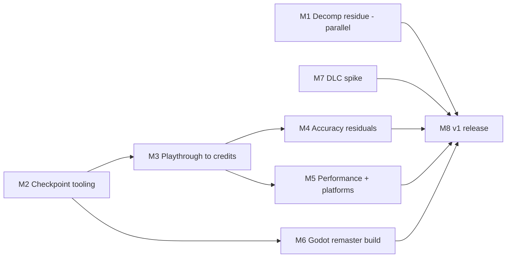

# Roadmap to v1

Agreed with the project lead on 2026-10-27. v1 is the final planned release; after it the project only takes patches (see M8). No dates: each milestone is closed by its gate. Linux desktop is the primary platform; Windows and Steam Deck must work.

This roadmap states goals, not achieved results. Nothing here claims that the game is playable to completion, that the decompilation is complete, or that Windows or Steam Deck have been validated on hardware; see [Getting started](GETTING_STARTED.md#status-reviewed-2026-10-20) for dated observations.

## v1 definition

1. **Faithful port (SDL `dq9`)**: a host built locally from the user's own copy can play the European game from new game to the end credits, with persistent saves, on Linux. It runs statically recompiled original code ([architecture](ARCHITECTURE.md)).
2. **Remaster build (Godot host)**: the same core with optional presentation upgrades. 1x mode is pixel-identical to SDL, and presentation settings never change simulation state.
3. **Decompilation**: work on the remaining unmatched functions runs in parallel until v1; 100% is the stretch goal. Whatever remains at release is classified and documented with its blocker. Coverage totals stay private ([decompilation status](DECOMP_STATUS.md)).
4. **DLC**: investigated only for content already present on the user's own cartridge image, enabled offline, never distributing game data (M7 decides).
5. **Out of scope**: local wireless multiplayer, tag mode, online services, and Windows/Deck performance tuning beyond "works".

Data policy unchanged: no ROM, ROM-derived bytes, assets, saves, captures, generated game code or game builds enter this repository or any release ([LEGAL.md](../LEGAL.md)).

## Starting state (2026-10-27)

| Area | State |
|---|---|
| Runtime and tools | Recompiler, hardware runtime, SDL and Godot host sources, matching/integration tools are public; source-only pre-releases up to v0.4.4 |
| Observed locally | Builds from the user's copy reach the opening credits in all five languages; scripted Linux runs reached an early field scene |
| Not verified | Story past the opening, battle at scale, save/load across sessions, sustained interactive play and pacing, a game run on Windows, Steam Deck hardware |
| Godot | Host, render-state capture and opt-in GPU 3D sources exist ([remaster stage 1](REMASTER_STAGE1.md)); milestone G2-G4 status to be audited in M6 |

The earlier feasibility gates F0-F3 are superseded: the native static-recompilation path is in place.

## M1 Decomp residue push (parallel until v1)

**Work:** toolchain fixes in blocker order: label synthesis for raw immediate branches, word-aligned Thumb unit grouping, units that own the data adjoining a function, relocation-aware assembly verification; authoring waves on functions without a known blocker, integrated with `tools/integrate_batch.py` in chunks of 20; ARM7 coverage accounting.

**Gate:** `tools/status.py --modules` reports every module check passing; `tools/rom_compare.py` differs only in the secure area and header CRC16; every unmatched function is recorded with its blocker (locally). Stretch: 0 unmatched.

## M2 Checkpoint and triage tooling

**Work:** a local checkpoint ladder: one save per story chapter plus key systems (first battle, vocation change, alchemy, grotto), each with a short scripted segment (12-frame held input) and recorded frame hashes, save bytes and audio. A local regression runner replays every segment natively and against a reference emulator where available. Debug-bundle intake (`tools/debug_bundle.py`) produces a reproducible segment from each reported issue. Saves and recordings stay local; only the tooling is published.

**Gate:** runner replays all existing checkpoints deterministically twice with identical hashes and save bytes; one bundle-to-segment round trip demonstrated.

## M3 Playthrough to credits

**Work:** the project lead plays the SDL build on Linux from new game to the credits, saving checkpoints at every chapter and filing bundles for any defect; fixes land with a regression segment. Subsystem matrix tracked: field, battle (spells, coup de grâce, party AI), menus, shops, alchemy, vocations, quick save/full save (EEPROM 64K), real-time-clock features, touch input, music/SFX.

**Gate:** credits reached natively; save reload verified after a process restart at each checkpoint; zero open blocker defects; matrix has no unverified row.

## M4 Accuracy residuals

**Work:** remaining native vs reference-emulator divergences found in M3 segments: late top-screen 3D differences from differing submitted draw state, cartridge-load timing, any audio drift. One hypothesis per change.

**Gate:** `tools/regress_frames.py` exit 0; all checkpoint segments within documented tolerances; every remaining difference listed with cause.

## M5 Performance and platforms

**Work:** sustained full speed (59.83 Hz) with headroom on Linux in the heaviest M3 scenes; optimizations compared A/B with a deterministic instruction metric (`perf stat` instructions, single render thread); the Windows kit runs the game; Steam Deck runs with controller input and save persistence.

**Gate:** Linux: over a 10-minute battle-heavy live run, measured wall-clock frame times meet the 59.83 Hz deadline with no missed frames and the frontend logs no audio underruns or drops (instruction counts do not prove real-time speed). Windows and Deck: lead-performed smoke run (boot, load checkpoint, battle, save, restart, reload) passes. These are user-verified, not CI-verified.

## M6 Godot remaster build

**Work:** audit G0-G4 ([Godot port plan](GODOT_PORT_PLAN.md)); finish G2 playable, G3 hosting (layouts, rebinding, scaling, debug bundles), G4 stage 1 (hi-res 3D with a 1x exact mode, [remaster stage 1](REMASTER_STAGE1.md)). Packaged alongside SDL.

**Gate:** 1x mode 3000-frame hashes identical to SDL; toggling presentation during a checkpoint segment leaves frame-state hashes and save bytes unchanged; one M3 checkpoint played start-to-finish in Godot on Linux.

## M7 DLC spike

**Work:** determine which downloadable content (quests, shop stock, guests) is present but flag-gated on the cartridge image versus delivered only over the network. If on-image content exists, an offline enabling tool that operates on the user's own save and ships no game data.

**Gate:** written finding; either a working tool verified on a local checkpoint save, or DLC documented as out of scope.

## M8 v1 release and patch policy

**Work:** beginner README (user supplies their own ROM); final source-only kits for SDL and Godot; release notes with the verified-vs-unverified matrix; patch policy: a `v1.x` branch that accepts only crash, save-corruption, progression-blocking and build-breakage fixes, each with a regression segment.

**Gate:** exact-head CI green; fresh-clone package byte-compared to the downloaded release; `tools/audit_package.py` finds no forbidden files; tag matches packaged HEAD.
